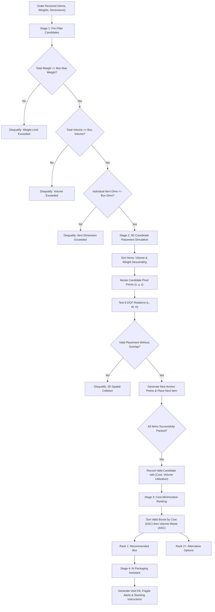

# AI-Assisted Box Selection System

> **A production-ready Django application that solves ecommerce order packaging optimization by combining 3D geometric bin packing, weight capacity limits, cost minimization, and context-aware AI warehouse guidance.**

[](https://www.djangoproject.com/)
[-brightgreen.svg)](#running-automated-tests)
[](https://www.python.org/)
[](LICENSE)

---

## Table of Contents
- [Problem Overview](#problem-overview)
- [Key Features](#key-features)
- [Algorithmic Architecture](#algorithmic-architecture)
- [System Architecture & Data Models](#system-architecture--data-models)
- [Getting Started & Installation](#getting-started--installation)
- [Web Interface Walkthrough](#web-interface-walkthrough)
- [REST API Documentation](#rest-api-documentation)
- [Running Automated Tests](#running-automated-tests)
- [Submission Deliverables Checklist](#submission-deliverables-checklist)

---

## Problem Overview

In high-volume ecommerce fulfillment warehouses, selecting the wrong shipping container results in:
1. **Excessive Procurement & Freight Costs**: Paying for larger boxes or volumetric shipping weight fees.
2. **Transit Damage & Returns**: Weak boxes collapsing or fragile items rattling in excessive empty void space.
3. **Operational Bottlenecks**: Warehouse dispatchers manually guessing whether a mixed order will fit inside a given box.

This system provides **instant, mathematically sound, and cost-optimal box recommendations** for any customer order while strictly adhering to 3D physical boundaries and maximum weight capacities.

---

## Key Features

- **3D Coordinate Placement & Collision Detection**:
  - Pure-Python geometric packing heuristic.
  - Generates exact non-overlapping Cartesian coordinates $(x, y, z)$ for each item.
  - Supports 6-degree-of-freedom $(L, W, H)$ rotations, with restrictions for upright items (e.g. liquids).
- **Multi-Constraint Optimization**:
  - **Weight Ceiling**: Rejects boxes if total payload exceeds the container's structural rating.
  - **Volumetric Bound**: Rejects boxes if combined item volume exceeds internal capacity.
  - **Cost-First Ranking**: Automatically recommends the cheapest valid container among all viable candidates.
  - **Space Utilization Tie-Breaker**: Selects the container with the highest packing density when costs are identical.
- **AI Packaging Assistant**:
  - Computes void-fill volume $(\text{cm}^3)$ and recommends appropriate cushioning (kraft paper, bubble wrap, air pillows).
  - Flags fragile merchandise with warning label and clearance instructions.
  - Enforces structural weight distribution (heavy items at base, light items on top).
  - Specifies closure standards (e.g., heavy-duty H-taping for heavy loads).
- **Interactive Warehouse Dashboard & Simulator**:
  - Live 3D box calculator supporting both existing database orders and custom ad-hoc dimension inputs.
  - Visual volume utilization and weight capacity progress bars.
  - Comprehensive rejection audit showing exact reasons why disqualified boxes failed.
- **Enterprise REST API**:
  - Clean `POST /api/recommend/` endpoint designed for seamless integration with ERP, WMS, and checkout platforms.
- **Multi-Box Partitioning Fallback**:
  - When an order exceeds any single box in the warehouse, the system automatically calculates a multi-box shipment plan.

---

## Algorithmic Architecture

The **3D Bin Packing Problem (3D-BPP)** is an NP-hard combinatorial optimization problem. Our solution employs a high-performance **Anchor-Point First-Fit Decreasing (FFD)** algorithm:



### 3D Non-Overlap Condition
Two placed cuboids $A$ and $B$ are non-overlapping if and only if they are disjoint along at least one Cartesian axis:
$$\neg \Big( (A_x < B_x + B_l \land A_x + A_l > B_x) \land (A_y < B_y + B_w \land A_y + A_w > B_y) \land (A_z < B_z + B_h \land A_z + A_h > B_z) \Big)$$

---

## System Architecture & Data Models

The system is built on a modular Django architecture:

```
box_selection_system/
├── box_selection/                  # Core domain application
│   ├── management/commands/        # Seed data & utilities
│   │   └── seed_data.py            # Pre-populates realistic boxes, items & orders
│   ├── services/                   # Decoupled business logic
│   │   ├── packer.py               # Pure-Python 3D coordinate placement engine
│   │   ├── recommender.py          # Candidate ranking & multi-box partitioner
│   │   └── ai_assistant.py         # AI warehouse guidance & void-fill generator
│   ├── templates/box_selection/    # Responsive Bootstrap 5 UI
│   │   ├── base.html
│   │   ├── dashboard.html
│   │   ├── simulator.html
│   │   ├── box_list.html
│   │   ├── product_list.html
│   │   ├── order_list.html
│   │   └── order_detail.html
│   ├── models.py                   # Box, Product, Order, OrderItem, History
│   ├── serializers.py              # Django REST Framework serializers
│   ├── views.py                    # REST API & Web UI controllers
│   ├── urls.py                     # Route definitions
│   └── tests.py                    # 19 comprehensive unit & integration tests
├── .github/workflows/              # Continuous Integration
│   └── django_tests.yml            # Automated test runner across Python 3.10-3.12
├── AI_USAGE.md                     # Transparent AI tool usage disclosure
├── LEARNINGS.md                    # Engineering takeaways & domain reflections
├── TEST_OUTPUT.md                  # Complete terminal log of test run
├── requirements.txt                # Project dependencies
└── manage.py                       # Django CLI entrypoint
```

---

## Getting Started & Installation

### 1. Prerequisites
- Python 3.10 or higher
- Git

### 2. Setup Virtual Environment & Install Dependencies
```bash
# Clone the repository
git clone <your-repo-link>
cd <repo-folder>

# Create and activate a virtual environment
python -m venv .venv

# On Linux/macOS:
source .venv/bin/activate
# On Windows:
.venv\Scripts\activate

# Install dependencies
pip install -r requirements.txt
```

### 3. Run Database Migrations
```bash
python manage.py migrate
```

### 4. Seed Realistic Demo Data
Populate realistic shipping box sizes, catalog items, and sample customer orders:
```bash
python manage.py seed_data
```

### 5. Launch Development Server
```bash
python manage.py runserver
```
Navigate to:
- **Warehouse UI Dashboard**: `http://127.0.0.1:8000/`
- **Interactive Box Simulator**: `http://127.0.0.1:8000/simulator/`
- **Orders Queue**: `http://127.0.0.1:8000/orders/`
- **Django Admin**: `http://127.0.0.1:8000/admin/`

---

## REST API Documentation

### Recommend Box for an Order / Custom Items
- **Endpoint**: `POST /api/recommend/`
- **Content-Type**: `application/json`

#### Example 1: Custom Ad-hoc Items
```bash
curl -X POST http://127.0.0.1:8000/api/recommend/ \
  -H "Content-Type: application/json" \
  -d '{
    "items": [
      {
        "name": "Mechanical Keyboard",
        "length": 44.0,
        "width": 14.0,
        "height": 4.5,
        "weight": 1.15,
        "quantity": 1,
        "is_fragile": false,
        "allow_rotation": true
      },
      {
        "name": "Coffee Mug",
        "length": 12.0,
        "width": 10.0,
        "height": 11.0,
        "weight": 0.38,
        "quantity": 1,
        "is_fragile": true,
        "allow_rotation": true
      }
    ]
  }'
```

#### Example 2: Recommendation for an Existing Order
```bash
curl -X POST http://127.0.0.1:8000/api/recommend/ \
  -H "Content-Type: application/json" \
  -d '{"order_id": 1}'
```

#### Sample Successful JSON Response:
```json
{
  "success": true,
  "message": "Optimal box found: Medium Flat Shipper ($2.20)",
  "recommended_box": {
    "box_id": 2,
    "name": "Medium Flat Shipper",
    "code": "BOX-M-FLAT",
    "dimensions": { "length": 45.0, "width": 25.0, "height": 8.0 },
    "cost": 2.2,
    "box_volume_cm3": 9000.0,
    "max_weight_kg": 5.0,
    "total_order_weight_kg": 1.53,
    "total_order_volume_cm3": 4094.0,
    "volume_utilization_pct": 45.5,
    "weight_utilization_pct": 30.6,
    "items_packed_count": 2,
    "coordinates": [
      { "name": "Mechanical Keyboard", "x": 0.0, "y": 0.0, "z": 0.0, "length": 44.0, "width": 14.0, "height": 4.5, "weight": 1.15 },
      { "name": "Coffee Mug", "x": 0.0, "y": 14.0, "z": 0.0, "length": 12.0, "width": 10.0, "height": 11.0, "weight": 0.38 }
    ]
  },
  "alternatives": [
    { "box_id": 3, "name": "Standard Medium Box", "code": "BOX-M", "cost": 2.8, "cost_diff": 0.6, "volume_utilization_pct": 27.3, "weight_utilization_pct": 19.1 },
    { "box_id": 4, "name": "Large Heavy-Duty Box", "code": "BOX-L", "cost": 4.5, "cost_diff": 2.3, "volume_utilization_pct": 6.8, "weight_utilization_pct": 8.5 }
  ],
  "rejected_boxes": [
    {
      "box_id": 1,
      "name": "Small Mailer Box",
      "code": "BOX-S",
      "cost": 1.5,
      "reason": "Product 'Mechanical Keyboard' dimensions (44.0×14.0×4.5 cm) exceed box dimensions (20.0×15.0×10.0 cm) in all rotations."
    }
  ],
  "ai_notes": {
    "summary": "Recommended 'Medium Flat Shipper' (BOX-M-FLAT) providing 45.5% volume utilization and 30.6% weight capacity. Loose fit (45.5% utilized). Significant void space (4,906 cm³). Use inflatable air pillows or biodegradable packing peanuts to fill empty space and prevent internal movement.",
    "cushioning_level": "High Cushioning / Air Pillows Required",
    "void_volume_cm3": 4906.0,
    "handling_precautions": [
      "FRAGILE ITEM WARNING: Order contains fragile merchandise: 'Coffee Mug'. Maintain at least 2.5 cm of cushioning buffer between items and box walls. Affix bright red 'FRAGILE - HANDLE WITH CARE' warning labels on all 4 vertical faces."
    ],
    "stacking_instructions": [
      "Base layer: Place the heaviest item 'Mechanical Keyboard' (1.15 kg) flat at the center bottom to maintain a low center of gravity.",
      "Top layer: Place lighter items such as 'Coffee Mug' (0.38 kg) on top to prevent crush damage."
    ],
    "tape_and_closure": "Standard single-strip taping on top and bottom center seams"
  }
}
```

---

## Running Automated Tests

Run the full automated test suite using Django's test runner:
```bash
python manage.py test -v 2
```

### Test Results
```text
Ran 19 tests in 0.200s

OK
```
See the complete terminal trace in [TEST_OUTPUT.md](TEST_OUTPUT.md).

---

## Submission Deliverables Checklist

- [x] **README.md**: Architectural overview, setup instructions, algorithmic approach, and API documentation.
- [x] **AI_USAGE.md**: Thorough disclosure of tools used, prompts, accepted outputs, rejected ideas, mistakes caught, and verification steps.
- [x] **LEARNINGS.md**: Technical reflections on the 3D-BPP, logistics trade-offs, and software design.
- [x] **TEST_OUTPUT.md**: Verified terminal output from `python manage.py test -v 2`.
- [x] **Automated Test Cases**: 19 unit & integration tests covering models, 3D rotations, weight ceilings, cost optimization, and API endpoints.
- [x] **CI/CD Pipeline**: `.github/workflows/django_tests.yml` configured for matrix testing on Python 3.10, 3.11, and 3.12.
- [x] **Interactive Web UI**: Operational dashboard, visual simulator, and printable packing slip view.
